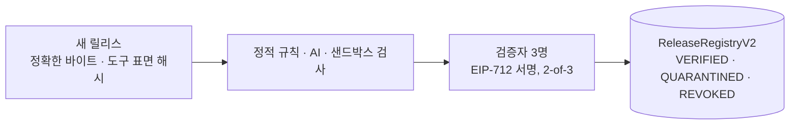
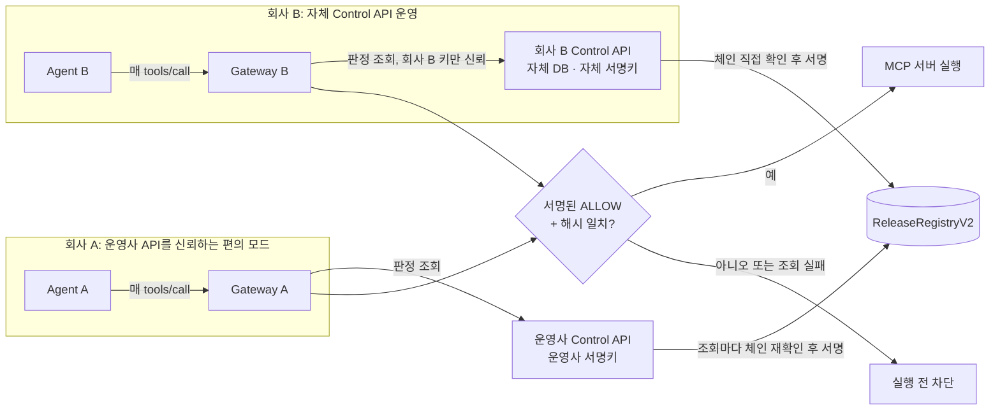

# MCPShield

## 멘토·심사위원께 (2026-10-26 업데이트)

MCPShield는 AI Agent가 쓰는 MCP 서버의 **새 버전마다** 정확한 배포본을 검사하고, 여러 회사가 나눠 맡도록 설계한 검증자 3명 중 2명의 판정(2-of-3)을 블록체인에 기록한 뒤, Gateway가 **도구를 실행하기 직전에** 그 판정을 강제하는 공급망 보안 프로토타입입니다.

MCP 서버 목록 사이트에는 비슷한 이름의 스캐너가 여럿 있습니다. MCPShield의 차이는 세 가지입니다: **업데이트마다 재검증 · 실행 전 강제 · 다기관 판정**.
실제 사례로 2025년 9월 npm `postmark-mcp` 패키지가 업데이트 한 번으로 보내는 모든 메일을 외부 주소로 몰래 숨은참조(BCC)하도록 바뀐 사례가 보고되었습니다. 우리 메일 MCP 시나리오와 거의 같은 구조입니다(원 출처는 확인 후 링크를 답니다. [v2.1 §18.0](docs/MCPShield_캡스톤_최종_마스터문서_v2.1.md) 참고).

### 먼저 보실 곳

1. [3차 멘토링 응답: 직접 확인하는 방법](docs/mentoring-3rd-response.md) — Base Sepolia 거래 링크, 두 회사 허용·차단 화면, 검증자별 증거 해시 대조, 고정 40개 표본 평가 결과를 설치 없이 볼 수 있게 정리했습니다.
2. [1차 멘토링(2026-10) 응답](docs/mentoring-2026-10-response.md) — 받은 의견별로 무엇을 결정·구현했고 무엇이 남았는지 정리했습니다.
3. [캡스톤 최종 마스터 문서 v2.1](docs/MCPShield_캡스톤_최종_마스터문서_v2.1.md) — 현재 기준 문서입니다. [v2.0](docs/MCPShield_캡스톤_최종_마스터문서_v2.0.md)은 비교용으로 보존합니다.
4. 팀 결정 기록(ADR)
   - [ADR-003 검증자 설계: 쓰는 회사가 곧 검증자](docs/adr-003-validator-consortium.md)
   - [ADR-004 블록체인이 필요한 장면](docs/adr-004-blockchain-necessity-scene.md)
   - [ADR-005 최종 데모 경로](docs/adr-005-capstone-demo-path.md)
   - [ADR-006 재검사 정책](docs/adr-006-gateway-recheck-policy.md)
   - [ADR-007 owner 권한 운영](docs/adr-007-registry-owner-governance.md)
   - [ADR-008 검증자별 증거 서명과 반대표 기록](docs/adr-008-independent-evidence-and-dissent.md)
   - [ADR-009 빠른 체인에서의 Gateway 체인 판정](docs/adr-009-chain-reader-on-fast-chains.md)
5. 2개 회사 장면 자동 테스트: [`tests/integration/consortium-scene.test.ts`](tests/integration/consortium-scene.test.ts) (하네스: [`consortium-scene.ts`](tests/integration/consortium-scene.ts), `npm run test:backend`에 포함되어 CI 대상, CI 결과는 PR 후 확인)
   - 측정까지 직접 실행: `npm run evaluate:consortium-scene` (기본 표본 50, Windows PowerShell은 `npm.cmd run evaluate:consortium-scene`)
   - 결과 파일: `benchmarks/results/consortium-scene-<커밋 7자리>[-dirty-<소스 해시 8자리>]-<측정 시각>.json`. 작업 트리가 깨끗하지 않거나(`--allow-dirty`를 주면 그 사실을 기록하고 진행) 장면 조건이 하나라도 깨지면 파일을 쓰지 않고, 기존 파일을 덮어쓰지 않습니다.

### 현재 상태

| 상태 | 항목 | 경계 |
|---|---|---|
| 완료 | v2.1 기준 문서, ADR-003~007, 멘토링 응답 문서 | 문서·결정 기록입니다. v2.0은 보존합니다. |
| 완료 | GitHub 기본 브랜치를 `master/main`으로 변경 | 이전 `main`은 9월 초 해커톤 상태 그대로입니다. |
| 로컬 구현·검증 | 회사 A·B 두 Gateway 장면: 운영사 장애, 악성 업데이트 폐기(두 Gateway 모두 실행 전 거부), 운영사 admission 서명 키 탈취, 검증자 직접 긴급 격리 | Ganache 로컬 EVM(`LOCAL_EVM`)에서 실행합니다. 스캐너는 고정 보고서 대역(`REPORT FIXTURE`)이며 실제 Docker 검사는 이 장면에 포함되지 않습니다. 검증자 3명은 팀이 운영하는 테스트 키로 운영사 템플릿에 서명합니다(결과 표시 `SINGLE_INSTITUTION_DEMO`, `SIGNS_OPERATOR_TEMPLATE_NO_INDEPENDENT_RESCAN`). |
| 로컬 구현·검증 | 실행 오버헤드 측정: Gateway 유무별 도구 호출 지연(stdio 기준), 긴급 격리 후 각 Gateway 차단까지 시간, 장애 시 읽기·쓰기 동작(5개 경우, 만료 캐시 포함) | 공식 측정(커밋 `f85f8e8`, Windows 개발 PC·Node v24.13.0, 표본 50): 호출 p50 직접 0.24 ms / Gateway A 62.87 ms / Gateway B 61.69 ms, 긴급 격리 후 다음 호출 거부까지 A·B 각 126 ms([결과 JSON](benchmarks/results/consortium-scene-f85f8e8-2026-10-10T18-00-42-747Z.json)). 로컬 체인은 즉시 채굴이라 전파 시간은 하한값입니다. 2-of-3 폐기가 실행 중 세션에 전파되는 시간은 아직 재지 않았습니다. |
| 다음 단계 | `docker compose`·대시보드를 회사 2개 스택(V2 + 서명 admission)으로 이전 | 현재 Compose는 V1 + 레거시 무서명 admission입니다. |
| 완료 | Base Sepolia에 ReleaseRegistryV3 배포, 승인·긴급 격리·폐기 거래 10건, 두 회사 Gateway의 체인 직접 판정(1.0.0 허용, 1.0.1 차단) | 검증자 3곳과 관리자 키는 팀이 운영합니다. 운영사 API·인덱서·`docker compose`는 아직 V3로 옮기지 않았습니다([3차 응답](docs/mentoring-3rd-response.md)). |
| 부분 완료 | 실제 AI 모델 호출: 고정 40개 표본 × 로컬 모델 2개 × 3회 반복 | 소형 로컬 모델은 탐지를 거의 더하지 못했습니다(결과 그대로 보고). 무료 GPT·Gemini 재실행은 준비만 끝났습니다. |

### 보장 범위

- Gateway는 판정이 바뀐 뒤의 **다음 도구 호출**을 막습니다. 이미 실행 중이거나 끝난 호출을 멈추거나 되돌리지는 못합니다.
- stdio Gateway는 실행 중 세션에서 호출을 거부하면 그 세션을 끝냅니다. 다시 쓰려면 새 세션이 실행 전 판정을 통과해야 합니다.
- 이미 보낸 메일처럼 밖으로 나간 결과는 되돌릴 수 없습니다. MCPShield는 복구 도구가 아니라 실행 전 차단 도구입니다.
- Gateway를 거치지 않고 MCP 서버를 Agent에 직접 연결하면 통제 범위 밖입니다.

### 피드백 남기는 방법

- GitHub Issue: [멘토 피드백 템플릿으로 이슈 열기](https://github.com/sihoon-0077/MCPShield/issues/new?template=mentor-feedback.md) (템플릿이 보이지 않으면 [빈 이슈](https://github.com/sihoon-0077/MCPShield/issues/new)로 남겨 주셔도 됩니다)
- 또는 [Pull Request](https://github.com/sihoon-0077/MCPShield/pulls)의 해당 줄에 코멘트를 남겨 주세요.
- 가능하면 **ADR 번호나 문서 절**(예: `ADR-004`, `v2.1 §4`)을 함께 적어 주세요. 어느 결정에 대한 의견인지 바로 연결할 수 있습니다.

## Master 구현 브랜치

새 개발자는 **[개발 인수인계 — 여기서 시작](DEVELOPMENT_HANDOFF.md)**을 먼저 읽으세요.

`master/main`은 GitHub 기본 브랜치이며, 원본 해커톤 데모를 보존하면서 캡스톤 요구사항을 확장하는 통합 브랜치입니다.
**아직 전체 구현·운영 검증 완료 상태는 아닙니다.** 아래 공개 URL에는 이 브랜치의 최신 코드가 자동 배포되지 않습니다.

- 현재 기능과 미검증 경계: [요구사항 추적표](docs/master-implementation-plan.md)
- 비공개 운영 콘솔·worker·PostgreSQL·검증자 구성: [운영 가이드](docs/operations-runbook.md)
- 실제 Linux Docker·PostgreSQL·서명 이미지의 확인된 기준: [CI 34250549056 / 5cabc48](https://github.com/sihoon-0077/MCPShield/actions/runs/34250549056)

새 기능은 tenant 권한·암호화 증거·내구성 queue/outbox·V2 정책·서명된 admission·고위험 action receipt를 포함합니다.
준비된 npm 실행 이미지와 전체 검증 흐름의 연결은 진행 중이며, 실제 외부 AI·테스트넷·독립 검증기관 검증은 별도입니다.

## Judge Lab

> 아래 공개 데모(Railway)는 원본 해커톤 데모이며 이번 v2.1 개정으로 바뀌지 않았습니다. `LOCAL_DEMO` 원장을 쓰므로 [ADR-005](docs/adr-005-capstone-demo-path.md)의 최종 데모 경로(ReleaseRegistryV2 + 서명 admission + 회사 2개 Gateway)나 테스트넷 증거가 아닙니다.

Public demo: `https://mcpshield-judge-lab-production.up.railway.app/try`

ChatGPT remote MCP endpoint: `https://mcpshield-judge-lab-production.up.railway.app/mcp`

The `/mcp` endpoint serves the synthetic `list_messages` tool over Streamable HTTP. The tool is marked read-only, and every call still passes the exact release admission check before the local stdio artifact can start.

`http://localhost:3000/try` provides an installation-free, no-wallet judge flow over the two fixed synthetic fixtures. It runs the real Scanner, creates two EIP-712 demo-validator signatures, executes the verified safe artifact through the Gateway, and proves the revoked artifact is blocked before spawn. Sessions are isolated in memory, expire after 15 minutes, and accept no uploads or external targets.

Enable the Backend route with `MCPSHIELD_JUDGE_DEMO_ENABLED=true`; the provided Compose stack enables it for loopback-only demo use. Results are explicitly labelled `LIVE DEMO` and `LOCAL_DEMO LEDGER`, not testnet evidence.

MCPShield는 MCP 서버의 이름이나 서명만 신뢰하지 않고, **정확한 배포 바이트와 도구 표면, 정적·AI·샌드박스 증거, 2-of-3 검증자 판정**을 묶어 실행 직전에 `ALLOW` 또는 `BLOCK`을 강제하는 Release Firewall 프로토타입입니다.

> Registry는 무엇을 설치할 수 있는지 보여줍니다. MCPShield는 무엇을 실행해도 되는지 증명하고 강제합니다.

## 두 흐름: 검증과 실행 통제

MCPShield는 성격이 다른 두 흐름으로 나뉩니다. 하나의 파이프라인이 아닙니다.

**① 검증 흐름** — 릴리스마다 한 번, 사용자가 기다리는 실행 경로 밖에서 돕니다(pipe-and-filter).



**② 실행 통제 흐름** — 도구 호출마다, 사용자가 기다리는 동안 Gateway가 판정을 다시 조회합니다(proxy/interceptor). 회사마다 판정을 조회하는 경로가 다릅니다.



- 이 구성의 **Gateway A**는 운영사 서명만 확인하고 체인을 스스로 다시 보지 않습니다. 운영사 API는 DB가 아니라 체인에서 상태를 읽어 서명하므로 DB 조작만으로는 거짓 ALLOW가 나오지 않습니다. 남는 위험은 **운영사 admission 서명 키 탈취**와 **운영사 장애**입니다. 키가 탈취되면 A는 자기가 직접 보지 못한 폐기(탈취 중에 일어난 폐기, 새로 설치한 Gateway)에 대해 위조 ALLOW를 받아들입니다. 로컬 폐기 기록 파일은 A가 이미 본 폐기만 막습니다.
- **Gateway B**는 운영사에 연결하지 않습니다. 회사 B가 직접 운영하는 Control API가 체인을 읽고 회사 B 키로 서명합니다. 그래서 운영사의 서명 키가 탈취되거나 운영사가 멈춰도 체인의 판정대로 폐기된 버전을 막습니다(장면 하네스는 장악 시 폐기 버전 차단과 장애 시 정상 버전 계속 사용을 확인합니다). 이 차이가 블록체인이 필요한 장면입니다([ADR-004](docs/adr-004-blockchain-necessity-scene.md)).
- 한계: MVP에서는 운영사 API의 relayer 키가 곧 컨트랙트 owner 키입니다. 운영사 API 프로세스 전체가 장악되면 B도 거짓 ALLOW는 받지 않지만, 공격자가 검증자 비활성화·정책 폐지로 정상 릴리스까지 만료시켜 A·B 모두 멈출 수 있습니다(서비스 거부). 운영에서는 owner(멀티시그)와 relayer 키를 분리합니다([ADR-007](docs/adr-007-registry-owner-governance.md)).
- 기본값은 매 호출 재검사(strict)입니다. 판정 재사용 시간을 두면 그 시간이 곧 폐기된 버전이 더 실행될 수 있는 최대 시간이므로, 측정 후에만 정하고 공개합니다([ADR-006](docs/adr-006-gateway-recheck-policy.md)).
- 이 회사 2개 구성은 현재 로컬 EVM 자동 테스트로 구현되어 있으며, `docker compose` 데모 스택에는 아직 반영되지 않았습니다([ADR-005](docs/adr-005-capstone-demo-path.md)).

데모에 쓰는 고정 fixture:

- `mail-mcp@1.0.0`: 정상 fixture → `VERIFIED` → Gateway가 실행합니다.
- `mail-mcp@1.0.1`: 서명된 악성 업데이트 fixture → 목적 범위 변경과 dummy canary 유출 감지 → `REVOKED` → 두 Gateway가 spawn 전에 차단합니다.
- 실제 고객 정보, 외부 수집 서버, 운영 키는 사용하지 않습니다.

## 빠른 실행

요구사항은 Node.js 22 이상 25 미만입니다. Windows PowerShell에서 실행 정책으로 `npm`이 차단되면 `npm.cmd`를 사용하세요.

```powershell
npm.cmd ci
npm.cmd run build
npm.cmd test
npm.cmd run benchmark:security
```

외부 서비스가 필요 없는 고정 재현 데모:

```powershell
npm.cmd run demo:smoke
```

임시 Backend를 실제로 띄우고 등록, 스캔 저장, 서명된 2-of-3 판정, Gateway 실행·차단을 검증하는 데모:

```powershell
npm.cmd run demo:live-smoke
```

Docker가 설치된 환경의 전체 UI 스택:

```powershell
npm.cmd run stack:up
# http://localhost:3000
npm.cmd run stack:down
```

기본 Compose 스택은 로컬 EVM에 `ReleaseRegistry`를 배포한 뒤 배포 주소를 Backend와 indexer에 공유합니다. Backend health는 `EVM` 원장 모드를 확인하며, indexer가 시작 동기화를 완료한 뒤에만 데모 seed와 UI가 시작됩니다.

> **v2.1 기준과 다른 점:** 현재 Compose는 V1 `ReleaseRegistry`를 배포하고, 두 Gateway가 같은 Backend의 레거시 무서명 `/api` admission을 사용합니다. [ADR-005](docs/adr-005-capstone-demo-path.md)의 최종 데모 경로(ReleaseRegistryV2 + 서명 `/v1` admission + 회사 A·B 별도 Control API)로 Compose·대시보드를 옮기는 작업은 다음 단계입니다. 그 전까지 회사 2개 장면은 아래 명령(로컬 EVM 통합 테스트)으로 확인합니다.

```powershell
npm.cmd run test:backend                  # consortium-scene.test.ts 포함(표본 5)
npm.cmd run evaluate:consortium-scene     # 측정(기본 표본 50), 결과 JSON 저장
```

## 구성

| 영역 | 위치 | 구현 내용 |
|---|---|---|
| Security·AI | `services/scanner`, `demo/fixtures`, `benchmarks` | 정적 규칙, 구조화 AI 분석, 로컬 sandbox observer, dummy canary sink, 결과 스키마, 성능 평가 |
| Blockchain·Backend | `apps/api`, `apps/validator`, `apps/indexer`, `apps/reconciler`, `contracts` | Fastify API, SQLite projection, PostgreSQL migration, EIP-712 2-of-3 컨트랙트(최종 경로는 `ReleaseRegistryV2`, V1은 레거시·확장), 이벤트 수집과 복구 |
| Frontend·Gateway·DevOps | `apps/dashboard`, `apps/gateway`, `scripts/demo`, `docker-compose.yml` | LIVE/REPLAY 대시보드, stdio Gateway, spawn 전 차단, Compose, CI, 재현 데모 |
| Shared protocol | `packages/protocol`, `packages/contracts-sdk` | 고정 JSON Schema, TypeScript 계약, 컨트랙트 SDK |

## 신뢰 경계

- 릴리스는 이름이 아니라 `releaseId + artifactDigest + toolSurfaceHash`로 식별합니다.
- AI 출력은 단독으로 차단 권한을 갖지 않습니다. 고정 JSON Schema로 제한하고 결정적 규칙·sandbox 증거와 함께 사용합니다.
- 검증자 키는 API와 분리합니다. API와 컨트랙트가 EIP-712 서명, signer, nonce, deadline, 중복 투표를 각각 확인합니다.
- `VERIFIED`이 아니거나 두 해시 중 하나라도 다르거나 상태 조회가 실패하면 Gateway는 fail closed 합니다. 조직 indexer·직접 RPC 폴백을 켜지 않은 본선 구성에서, 판정 서버 장애 시 기본 strict 모드는 읽기·쓰기 모두 막고, balanced 모드는 아직 유효한 서명 캐시로 읽기 전용 호출만 허용하며 캐시로는 쓰기를 허용하지 않습니다. 폴백을 켜면 indexer의 새 서명 판정은 쓰기도, 직접 RPC는 읽기 전용 호출을 허용할 수 있습니다([ADR-006](docs/adr-006-gateway-recheck-policy.md)).
- raw evidence와 비밀은 체인에 기록하지 않고 evidence hash와 상태만 기록합니다.
- 컨트랙트 관리자(owner)는 MVP에서 단일 배포 키이며, 운영사 API의 relayer 키와 같습니다. owner 키가 장악돼도 체인의 `REVOKED`를 `VERIFIED`로 되돌릴 수는 없고, 즉시 권한(검증자 비활성화·정책 폐기)은 거짓 ALLOW가 아니라 서비스 중단(fail closed)으로 이어집니다. 다만 1일 지연 뒤에는 검증자 교체로 아직 폐기되지 않은 릴리스에 거짓 `VERIFIED`를 만들 수 있습니다. 이때 방어선은 공개되는 교체 예약 이벤트와 Gateway가 고정한 검증자 집합 버전입니다(MVP 기준, 자세한 내용과 운영용 멀티시그·타임락 계획은 [ADR-007](docs/adr-007-registry-owner-governance.md)).

## 원본 데모의 검증 기록

2026-09-04 로컬 통합 실행 기준:

- Backend/Contract 19개, Security 28개, Gateway 27개 테스트 통과
- clean-reset Replay smoke 10/10, 비-Docker LIVE E2E, indexer-first EVM E2E 통과
- Security benchmark 10쌍: TP 10, TN 10, FP 0, FN 0, recall/precision/canary detection 1.0
- Backend TypeScript와 Dashboard Next.js production build 통과
- 전체 tracked-file 비밀 스캔 통과, `npm audit --omit=dev` 운영 의존성 취약점 0건

이 수치는 정상·악성 fixture 각 1종을 반복한 해커톤용 소규모 측정이며 일반화된 탐지 성능 주장이 아닙니다. 상세 조건은 [평가 문서](docs/evaluation.md)를 참고하세요.

## 운영 전 제한

- Docker 격리는 위에 명시한 Linux CI 커밋에서 실제 검증했습니다. 이후 새 코드는 별도 재검증해야 하며, 로컬 preload observer는 커널 수준 격리 장치가 아닙니다.
- Base Sepolia 주소와 explorer 링크는 배포 키·RPC를 제공한 뒤 생성해야 합니다. 회사 2개 장면을 포함한 현재 체인 증거는 모두 로컬 EVM입니다.
- 검증자 3명은 데모에서 팀이 운영하는 테스트 키입니다. 운영에서 한 주체가 셋을 모두 운영하면 중앙 DB에 서명 3개를 붙인 것과 다르지 않고, 같은 스캐너·AI 모델을 쓰면 오류도 함께 날 수 있습니다. 참여 동기·비용 분담 설계는 [ADR-003](docs/adr-003-validator-consortium.md)에 있습니다.
- 실제 외부 AI 모델 호출과 품질 평가는 아직 실증하지 않았습니다.
- SQLite 데모와 PostgreSQL control-plane adapter·migration·별도 DB 복원 테스트를 제공합니다. 실제 운영 DB의 백업·부하·가용성은 운영 환경에서 검증해야 합니다.
- 본 프로토타입은 local stdio MCP를 우선 지원하며 모든 remote MCP를 완전 증명하지 않습니다.

자세한 내용: [구현 매트릭스](docs/implementation-matrix.md) · [아키텍처](docs/architecture.md) · [인터페이스 계약](docs/interface-contract.md) · [데모 시나리오](docs/demo-scenario.md) · [통합 체크리스트](docs/integration-checklist.md) · [보안 정책](SECURITY.md)
