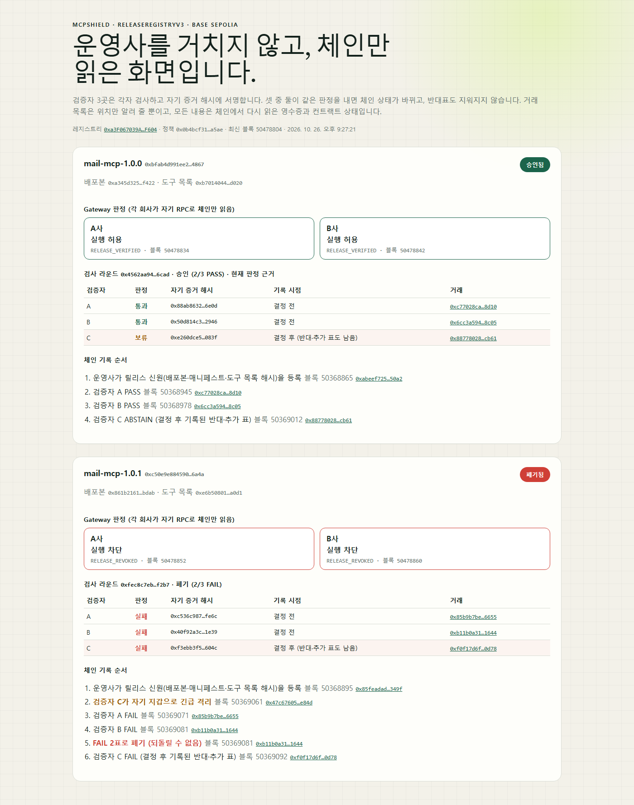

# 3차 멘토링(2026-10) 반영 결과: 직접 확인하는 방법

| 항목 | 내용 |
|---|---|
| 작성일 | 2026-10-26 |
| 작업 브랜치 | `capstone/adr-008-validator-evidence` ([PR #3](https://github.com/sihoon-0077/MCPShield/pull/3) `capstone/poc-tests-ci-green` 위에 쌓음) |
| 이 문서의 역할 | 3차 의견에서 꼭 보여 달라고 하신 세 가지를 무엇으로 했는지, 설치 없이 어디서 확인하는지 정리 |

**요약.** 세 가지 모두 실제 Base Sepolia 체인과 실제 모델 호출로 돌렸습니다.

- **① 승인·폐기·두 회사 차단:** 아래 거래 10건과 체인만 읽는 화면으로 확인할 수 있습니다.
- **③ 검증자 독립 검사·자기 증거 서명·반대표 기록:** 이를 위해 새 컨트랙트 ReleaseRegistryV3([ADR-008](adr-008-independent-evidence-and-dissent.md))를 만들어 배포한 뒤, 그 위에서 거래를 만들었습니다.
- **② AI 비교:** 고정 40개 표본에서 로컬 소형 모델 두 개는 탐지를 거의 더하지 못했습니다. 이 결과를 그대로 보고합니다. 무료 GPT·Gemini로 다시 돌릴 준비는 끝났고, 결과는 다음 커밋으로 더합니다.

---

## 1. 두 회사 화면: 운영사 없이 체인만 읽은 결과



- 2026-10-26 21:27(KST)에 실제 체인을 읽어 캡처했습니다.
- `mail-mcp 1.0.0`은 A사·B사 모두 실행 허용(`RELEASE_VERIFIED`)입니다.
- `mail-mcp 1.0.1`은 두 회사 모두 실행 차단(`RELEASE_REVOKED`)입니다.
- 회사 카드의 판정은 Gateway가 실제로 쓰는 체인 판정 함수(`directRpcAdmission`)를 각 회사의 RPC로 실행한 결과입니다. 운영사 API는 거치지 않습니다.
- Base Sepolia는 블록이 초당 약 5개 생깁니다. 그래서 기존 Gateway 규칙으로는 승인된 버전까지 막혔고, 이 규칙을 고쳤습니다([ADR-009](adr-009-chain-reader-on-fast-chains.md)).

## 2. Base Sepolia 거래 (클릭만 하면 됩니다)

컨트랙트(2026-10-26 배포, [배포 기록](../deployments/base-sepolia-v3.json)):

- ReleaseRegistryV3 [`0xa3F0…F604`](https://sepolia.basescan.org/address/0xa3F067039A119a06E8ec924b429936a0C7cEF604)
- ValidatorRegistry [`0x53cb…2cb2`](https://sepolia.basescan.org/address/0x53cb7B2bAdaAA689720869b7255189E2158d2cb2)
- PolicyRegistry [`0x3f7b…5800`](https://sepolia.basescan.org/address/0x3f7b94C6A6664E6ea03bf175F2337F2363445800)

| # | 블록 | 무슨 일 | 거래 |
|---|---|---|---|
| 1 | 50368835 | 기본 정책 게시 | [`0x3d46…3101`](https://sepolia.basescan.org/tx/0x3d464ad194609212d210c3623ea434975e6f659da22031a009fe041b70723101) |
| 2 | 50368865 | 1.0.0(정상) 신원 등록: 배포본·매니페스트·도구 목록 해시 | [`0xabee…50a2`](https://sepolia.basescan.org/tx/0xabeef7253bd826417fc901d6f2520004f7b37fb684ed5038ac434098abc050a2) |
| 3 | 50368895 | 1.0.1(악성) 신원 등록 | [`0x85fe…349f`](https://sepolia.basescan.org/tx/0x85feadad0479017fabe045f9acd26d4cc0f2f554dfdec8e9fed2bbb2637e349f) |
| 4 | 50368945 | 검증자 A PASS (1.0.0) | [`0xc770…8d10`](https://sepolia.basescan.org/tx/0xc77028ca29e035b517fafe14ef5a1f307952a54fa6462dd8c973053962658d10) |
| 5 | 50368978 | 검증자 B PASS (1.0.0), 2/3 PASS로 **승인** | [`0x6cc3…8c05`](https://sepolia.basescan.org/tx/0x6cc3a594d1da153fc4e3593fc41f7acdb42ef8a64e0f8e0d137fe5818fab8c05) |
| 6 | 50369012 | 검증자 C ABSTAIN (1.0.0), 결정 뒤 반대표로 기록. 연출한 표(아래 3절) | [`0x8877…cb61`](https://sepolia.basescan.org/tx/0x88778028a08be78313ebf1832a13d423a27ec6a030297fe6250dce4d736dcb61) |
| 7 | 50369061 | 검증자 C가 **자기 키로 직접** 1.0.1 긴급 격리 (사유 `CANARY_EXFILTRATION`) | [`0x47c6…e84d`](https://sepolia.basescan.org/tx/0x47c67605f3e5e68921ec4b73d87a929d49c4017fa08a84b0f1a083ebf1f4e84d) |
| 8 | 50369071 | 검증자 A FAIL (1.0.1) | [`0x85b9…6655`](https://sepolia.basescan.org/tx/0x85b9b7be7e8a4d7af40d6cdfa7891538eef53ad74c4a678bd869d770bc246655) |
| 9 | 50369081 | 검증자 B FAIL (1.0.1), 2/3 FAIL로 **폐기**(같은 배포본 바이트도 폐기) | [`0xb11b…1644`](https://sepolia.basescan.org/tx/0xb11b0a314eab3706262b7a1e4e95fb2f9b442593a743183432a67ee4f11b1644) |
| 10 | 50369092 | 검증자 C FAIL (1.0.1), 결정 뒤 표로 기록 | [`0xf0f1…0d78`](https://sepolia.basescan.org/tx/0xf0f17d6f8eeddd9e15b0342923e0c24845f79536353fac60dae7bbd6c4e10d78) |

- **표를 누가 보냈나:** 4~6번과 8~10번은 검증자가 EIP-712로 서명한 표를 중계 계정(`0x19f3…Cc6b`)이 제출한 것입니다. 그래서 Basescan의 보낸 사람(From)은 중계 계정으로 보입니다. 컨트랙트가 서명에서 검증자 주소를 복원해 등록된 검증자인지 확인합니다.
- **7번만 다릅니다:** 검증자 C가 자기 키로 직접 보냈습니다. 운영사가 없어도 검증자가 바로 막을 수 있다는 장면입니다.
- **전체 기록:** [transactions.json](../benchmarks/results/base-sepolia-v3-demo-2026-10-26/transactions.json)
- **실행 스크립트:** [base-sepolia-v3-demo.ts](../scripts/demo/base-sepolia-v3-demo.ts)

## 3. 검증자별 증거 해시 대조

검증자는 각자 자기 사본을 검사해 증거 파일을 만들고, 그 파일의 SHA-256을 `evidenceHash`로 서명합니다. 이 값은 체인의 `VoteRecorded` 이벤트에 남습니다(Basescan 거래의 Logs 탭). 저장소의 파일 해시가 이 값과 같으면, 그 표는 이 증거 파일에 근거한 것입니다.

| 릴리스 | 검증자 | 판정 | 증거 파일 | evidenceHash |
|---|---|---|---|---|
| 1.0.0 | A | PASS | [validator-A](../benchmarks/results/base-sepolia-v3-demo-2026-10-26/mail-mcp_1.0.0.validator-A.json) | `0x88ab8632…6e0d` |
| 1.0.0 | B | PASS | [validator-B](../benchmarks/results/base-sepolia-v3-demo-2026-10-26/mail-mcp_1.0.0.validator-B.json) | `0x50d814c3…2946` |
| 1.0.0 | C | ABSTAIN (연출) | [validator-C](../benchmarks/results/base-sepolia-v3-demo-2026-10-26/mail-mcp_1.0.0.validator-C.json) | `0xe260dce5…083f` |
| 1.0.1 | A | FAIL | [validator-A](../benchmarks/results/base-sepolia-v3-demo-2026-10-26/mail-mcp_1.0.1.validator-A.json) | `0xc536c987…fe6c` |
| 1.0.1 | B | FAIL | [validator-B](../benchmarks/results/base-sepolia-v3-demo-2026-10-26/mail-mcp_1.0.1.validator-B.json) | `0x40f92a3c…1e39` |
| 1.0.1 | C | FAIL, 7번 긴급 격리의 근거로도 사용 | [validator-C](../benchmarks/results/base-sepolia-v3-demo-2026-10-26/mail-mcp_1.0.1.validator-C.json) | `0xf3ebb3f5…604c` |

```bash
shasum -a 256 benchmarks/results/base-sepolia-v3-demo-2026-10-26/mail-mcp_*.json
```

Windows PowerShell에서는 `Get-FileHash -Algorithm SHA256 benchmarks\results\base-sepolia-v3-demo-2026-10-26\mail-mcp_*.json`을 씁니다.

- **1.0.1:** A·B·C의 검사가 모두 샌드박스에서 `CANARY_EXFILTRATION`(CRITICAL, 결정적 탐지)을 찾았습니다. 그래서 셋 다 FAIL입니다.
- **1.0.0 C의 ABSTAIN은 연출입니다.** "반대표도 지워지지 않는다"를 보이려고 넣었습니다. C 자신의 검사 결과(증거 파일)는 이상 없음입니다(아래 질문 3).

## 4. 고정 40개 표본 평가

- [결과 요약](../benchmarks/results/eval40-2026-10-26/summary.md)
- [표본·정답](../benchmarks/eval40/)
- [원자료](../benchmarks/results/eval40-2026-10-26/results.json)

평가 조건:

- **표본:** 정상 20개(어려운 정상 10개 포함)와 공격 20개입니다. 해시로 고정했습니다(`samples.lock.json`).
- **비교군 5개:** 정적 규칙만, AI만, 샌드박스만, 정적+샌드박스, 전체입니다.
- **판정 규칙:** V3 검증자와 같습니다. 규칙 위반이 확정되면 FAIL, AI의 HIGH 이상 의심이나 검사 미완료는 ABSTAIN입니다.
- **AI:** 로컬 모델 2개(qwen2.5-coder 7B, gemma4 e2b)로 표본 40개를 각 3회씩, 실제 호출 240회를 했습니다.

| 결과 | 수치 |
|---|---|
| 규칙(정적+샌드박스)이 FAIL로 잡은 공격 | 20개 중 11개 |
| 규칙이 정상을 FAIL로 잘못 막은 경우 | 20개 중 2개 (b07, h01) |
| AI 호출 실패 (형식·인용 위반, JSON 깨짐) | 240회 중 148회 |
| 성공한 AI 호출 중, 규칙이 놓친 공격 9개에서 AI가 HIGH 의심을 낸 경우 | 20회 중 3회 |
| 성공한 AI 호출 중, 규칙을 통과한 정상에서 AI가 잘못 의심한 경우 | 43회 중 2회 |
| AI 실패를 보류로 처리할 때 사람 검토로 가는 정상 업데이트 | 120회 중 67회 (56%) |

- **결론:** 이 소형 로컬 모델로는 "AI가 규칙이 놓친 공격을 잡는다"고 말할 수 없습니다. 그래서 발표에서 이 주장은 빼고, 무료 GPT-4.1 mini(GitHub Models)와 Gemini Flash로 같은 표본을 다시 돌려 판단합니다.
- **재실행 준비:** 연결용 중계기([ai-adapter.mjs](../benchmarks/eval40/ai-adapter.mjs))와, 무료 한도에 맞춰 여러 날에 나눠 돌리는 기능을 만들어 두었습니다.
- **MCPTox:** 외부 공개 공격 485건 결과는 이번 표와 섞지 않습니다. 기존 결과(정적 메타데이터 규칙 탐지율 25.98%)로 따로 보고합니다.

## 직접 실행해 보기 (선택, 비밀값 필요 없음)

Node 22~24에서 아래를 실행합니다.

```bash
npm ci
npm run build --workspace @mcpshield/dashboard
npm run start --workspace @mcpshield/dashboard -- -p 3100
```

브라우저로 `http://localhost:3100/ledger`를 열면 위 화면을 실제 체인에서 다시 만듭니다. 공개 RPC(`https://sepolia.base.org`)만 쓰므로 키가 필요 없습니다.

- **컨트랙트 테스트**(V3 19개 포함, 로컬 EVM): `npm run test:contracts`
- **Gateway 테스트:** `npm run test:gateway`
- **40개 평가 숫자 다시 계산**(AI 호출 없이, 저장된 결과로): `node --import tsx benchmarks/eval40/run.mjs --append benchmarks/results/eval40-2026-10-26/results.json --repeats 0 --out ./eval40-check`

## 3차 의견별 반영표

| 의견 | 한 일 | 상태 |
|---|---|---|
| ① Base Sepolia에서 승인·폐기·두 회사 차단을 거래 링크로 | V3를 배포하고 거래 10건을 만들었습니다. 두 회사 Gateway가 체인만 읽고 1.0.0은 허용, 1.0.1은 차단합니다. | 완료 |
| ② 고정 40개 표본, 실제 AI 호출, AI 있음/없음 비교, 반복 실행, MCPTox는 따로 | 비교군 5개, 로컬 모델 2개를 각 3회 반복했습니다. MCPTox는 따로 적었습니다. | 로컬 모델 완료. 무료 GPT·Gemini 재실행 준비 완료. 정답의 2인 검토 대기 |
| ③ 검증자 독립 검사, 자기 증거 해시 서명, FAIL·ABSTAIN 반대 기록, 배포 전에 반영 | ReleaseRegistryV3를 배포 전에 만들었습니다. 표마다 검증자 자신의 `evidenceHash`를 서명하고, 결정 뒤에 온 표도 기록합니다. V3 검증자 앱은 자기 사본을 직접 검사해 자기 증거 파일을 만듭니다. | 완료 (검증자 키 3개는 팀이 운영) |
| 갈린 표는 사람 검토로 | 3표가 모였는데 2표 합의가 없으면 SPLIT으로 둡니다. 상태는 UNVERIFIED(실행 차단)이고 `ReviewRequired` 이벤트를 남깁니다. | 완료 |
| 기능을 더 늘리지 말 것 | 위 세 가지에 필요한 것만 더했습니다. | — |

## 아직 안 된 것

- 무료 GPT·Gemini로 40개 평가를 다시 돌리는 일. 준비는 끝났습니다.
- 표본 정답의 2인 독립 검토([review-sheet.csv](../benchmarks/eval40/review-sheet.csv)).
- 검증자 독립 검사를 CI의 Docker 샌드박스에서 돌리는 일. 지금은 로컬 프로세스 샌드박스이고, 도구 호출 프로브가 없습니다.
- 운영사 API와 인덱서의 V3 전환. 지금 V3를 읽는 것은 체인 화면과 Gateway의 체인 판정입니다.
- 데모의 검증자 3곳과 관리자 키는 모두 팀이 운영합니다([ADR-003](adr-003-validator-consortium.md), [ADR-007](adr-007-registry-owner-governance.md)).

## 의견을 듣고 싶은 세 가지

1. **갈린 표 처리.** 세 검증자가 PASS·FAIL·ABSTAIN으로 갈리면 판정을 내지 않고 사람 검토로 보냅니다. 그동안은 실행을 막습니다(UNVERIFIED). 발표에서 이 정도면 충분한지, 검토 기한이나 담당 같은 절차까지 보여야 하는지 궁금합니다.
2. **AI의 역할.** 지금 결과로는 AI를 "의심이면 보류(ABSTAIN)" 신호로만 쓰고, FAIL은 규칙·샌드박스의 확정 증거로만 내는 것이 맞다고 봅니다. 무료 GPT·Gemini 결과가 나와도 이 방향이 맞을지 의견을 듣고 싶습니다.
3. **연출한 반대표.** 1.0.0에서 C의 ABSTAIN은 반대표 기록을 보이려고 연출했습니다. 발표에서 연출이라고 밝히고 써도 되는지, 아니면 실제로 의견이 갈리는 표본을 만들어 보여야 하는지 궁금합니다.
